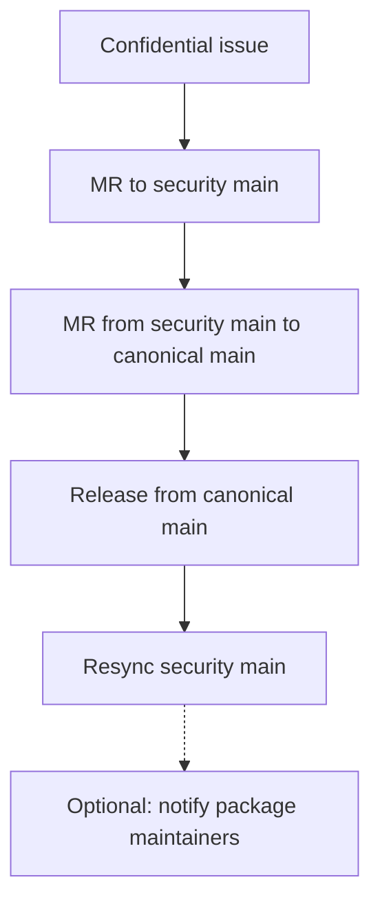

# Security releases

Security fixes are developed in the private
[`gitlab-org/security/cli`](https://gitlab.com/gitlab-org/security/cli) repository and
ship in a regular release from `main`. The CLI doesn't use patch release branches.

> [!warning]
> Never push a security fix, or a branch that contains one, to
> [`gitlab-org/cli`](https://gitlab.com/gitlab-org/cli). The project is public, so
> anything pushed there discloses the vulnerability.

## How the security repository works

`gitlab-org/security/cli` is a private fork of `gitlab-org/cli`. Its `main` branch
pull-mirrors canonical `main`. The mirror only updates `main`, and doesn't overwrite a
branch that has diverged. When a security fix merges into the security repository's
`main`, the mirror stops updating it until the fix is released and `main` is resynced.

Every fix merged into the security repository's `main` ships together in the next
release. Merge a fix only when it's ready to release.

The mirror is configured in the security repository's
**Settings > Repository > Mirroring repositories**: it pulls from `gitlab-org/cli`,
the branch filter is `main`, and overwriting diverged branches is off.

## Process



### Start with a confidential issue

A security fix starts with a confidential issue in `gitlab-org/cli` that describes the
vulnerability.

### Set up the security repository

Work in a separate clone of the security repository, so `origin` points to it and a
default `git push` can't reach the public project:

```shell
git clone git@gitlab.com:gitlab-org/security/cli.git glab-security
cd glab-security
lefthook install
```

Don't add `gitlab-org/cli` as a remote in this clone. To fetch canonical `main`, use
its URL, as the commands in this guide do.

### Develop the fix

1. Create a branch named `security-<issue number>`, for example `security-9999` for
   issue `#9999`.
1. Implement the fix and push the branch to the security repository.
1. Open a merge request that targets the security repository's `main`. Follow the
   same review process as any other change.
1. Request a review from `@ai-security-fix-reviewer-gitlab-org` and address its
   findings. Its review is advisory. Then get a PSIRT review: assign a member of
   `@gitlab-com/gl-security/product-security/psirt-group` as a reviewer, or mention
   the group in a comment
   ([example](https://gitlab.com/gitlab-org/security/cli/-/merge_requests/28)).
   PSIRT decides whether the fix needs a CVE.
1. When the fix is ready to release, merge it.

### Keep the public text neutral

Users stay exposed until they update, so the public record of a fix shouldn't explain
how to exploit it. When the fix reaches canonical `main`, more than the merge request
description becomes public:

- The canonical merge request's title, which becomes the commit message on `main`,
  and the release notes.
- Every commit message, including the security merge request's title. The
  public merge request lists them all, even when it's squashed.
- Comments and threads on the canonical merge request.
- Code comments, test names, and test descriptions.

Describe what the change does, not the attack it prevents. For example, write
`fix(config): restrict which keys repository config can set`, not
`fix(config): stop a malicious repository running arbitrary commands`.

Keep the vulnerability details in the confidential issue and the security merge
request, which stay private.

### Merge into canonical `main`

The merge request to `gitlab-org/cli` is public, so open it only when you're ready to
release. Use the security repository's `main` as the source:

```shell
glab mr create --repo gitlab-org/cli --head gitlab-org/security/cli \
  --source-branch main --target-branch main \
  --title "fix(scope): describe the fix" \
  --description "Merge the security fix from gitlab-org/security/cli." --yes
```

Pass `--description` so `glab` doesn't prompt for a template. Don't use `--fill`. It
pushes and adds a `gitlab-org/cli` remote. The title, description, and commits are
public, so follow [keep the public text neutral](#keep-the-public-text-neutral).

In the UI, go to **Code > Merge requests > New merge request** in
`gitlab-org/security/cli`, select `gitlab-org/security/cli` and `main` as the source,
and `gitlab-org/cli` and `main` as the target.

Merging runs the merged results pipeline and the merge train against the latest
canonical `main`. Squash is on by default, so the merge request title becomes the
commit message on `main`. Use a Conventional Commits title, such as `fix(auth): ...`.
For an example, see [!2841](https://gitlab.com/gitlab-org/cli/-/merge_requests/2841).

If canonical `main` has moved and the merge request has conflicts, resolve them in
the security repository, not in a public branch. Pushing to the security
repository's `main` needs the Maintainer role:

```shell
git checkout main
git pull origin main
git fetch https://gitlab.com/gitlab-org/cli.git main
git merge FETCH_HEAD
git push origin main
```

### Release

Release from canonical `main` straight away. Run the release schedule on demand. See
[forcing a release off-cycle](release_process.md#forcing-a-release-off-cycle).

Validate that the released binary fixes the vulnerability.

### Resync the security repository

After the release, reset the security repository's `main` to canonical `main`, so the
mirror resumes:

```shell
git fetch https://gitlab.com/gitlab-org/cli.git main
git push --force origin FETCH_HEAD:main
```

This needs the Maintainer role in `gitlab-org/security/cli`.

### Notify package maintainers

This step is optional. Homebrew, Snap, and Scoop update automatically after the
release. To get the fix to other packages sooner, you can email the maintainers of the
community-maintained packages. See
[notifying maintainers](release_process.md#notifying-maintainers).
